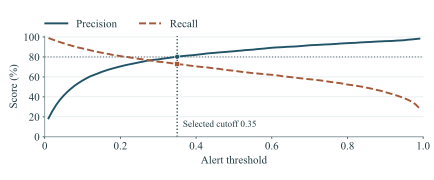

# DebateSignal

DebateSignal helps a human moderator follow a two-person debate in English. It transcribes speakers, flags possible personal attacks and sustained topic drift, and connects suggested arguments to the turns they refer to. The moderator can inspect the exact wording, correct a suggestion and export a record of the discussion.

[Run locally](#run-locally) · [Evaluation](#evaluation) · [Training notebook](notebooks/train_evaluate.ipynb) · [Technical guide](docs/technical-guide.md)

## A session from start to finish

1. **Set the motion.** Enter a debate question and optional participant names, or open an example to explore a prepared discussion.
2. **Follow the exchange.** Type turns or record two people through a shared microphone. Live transcription assigns speaker labels. The moderator can correct a label if voices overlap or a turn is too short to identify.
3. **Review flagged moments.** Each alert opens alongside its surrounding turns. A short prompt such as “What do you think?” is neutral. Two off-topic turns trigger a drift alert, and the queue stays quiet until participants return to the motion.
4. **Trace an argument.** Open the argument map to see which earlier statement a reply may support or challenge. Inspect the quoted source, correct the link, or leave it open. The session report collects these exchanges, outstanding questions and measured speaking time. Export the report as Markdown or the session as JSON.

## Run locally

Use Python 3.13 and uv. The full workspace also requires Node.js and npm (the container build uses Node.js 24). Start both paths from the repository root.

```sh
git clone https://github.com/moha-r/debate-signal.git
cd debate-signal
```

### Try the classifier

```sh
uv run --python 3.13 --with-requirements requirements.txt python app.py
```

Open [Gradio on port 7860](http://127.0.0.1:7860), choose **Sentence check**, and enter a sentence. The result shows the processed text, attack probability and alert decision. The saved classifier runs locally.

### Run the moderator workspace

```sh
npm --prefix frontend ci
npm --prefix landing ci
npm --prefix frontend run build
npm --prefix landing run build
uv run --python 3.13 --with-requirements requirements-voice.txt uvicorn local_dashboard:app --host 127.0.0.1 --port 7863 --ws-max-size 8192
```

Open the [workspace landing page](http://127.0.0.1:7863), create a local account, then choose **Explore an example** or **New debate**. Typed debates work without a transcription key. The first debate downloads the MiniLM topic encoder. To enable the microphone, set `ASSEMBLYAI_API_KEY` in the server environment before startup. Recording sends audio to AssemblyAI and saves the resulting transcript in the moderator’s local SQLite workspace.

## Evaluation

The deployed personal-attack classifier uses TF–IDF and a calibrated LinearSVC. On **22,921 held-out WikiDetox comments**, the selected alert rule caught **202 additional attacks** and raised **231 additional false alarms** compared with the original decision rule.

| Attack decision rule | Attack precision | Attack recall | Macro F1 |
| --- | ---: | ---: | ---: |
| Original LinearSVC | 87.54% | 66.59% | 0.8642 |
| Deployed alert at 0.35 | 80.37% | 74.13% | 0.8712 |

The figure shows how the threshold was chosen on a separate **validation** sample of 45,842 comments. At 0.35, recall was highest among the settings that met both requirements of 80% precision and at least 100 alerts. [Threshold sweep](results/validation_thresholds.csv) · [Held-out results](results/alert_benchmark.csv)



Other features were evaluated on different material. These results describe what a moderator can expect to review.

| Feature | Evaluation material | Result |
| --- | --- | --- |
| Topic drift | 24 authored discussions, 288 turns | Detected 17 of 18 sustained detours and raised two false alerts. [Audit (Arabic)](docs/evaluation/2026-11-18-expanded-audit-report.md) |
| Argument links | Pre-segmented turns from Moral Maze and QT30 broadcasts | 31.9% and 13.6% of suggested links matched both the reference turn and relation, respectively. Source links need human review. [Methods and limitations (Arabic)](reports/contextual_link_quality_ar.md) |

## Explore the repository

| If you want to… | Start here |
| --- | --- |
| Reproduce the preprocessing, model selection and error analysis | [Executed training notebook](notebooks/train_evaluate.ipynb) |
| Compare the optional DistilBERT experiment | [Executed experiment](notebooks/train_distilbert.ipynb) · [Evaluation figures](reports/figures/) |
| Inspect how a debate turn becomes an alert | [Session logic](moderation_session.py) · [Topic scoring](topic_relevance.py) |
| Work on the web application | [React workspace](frontend/) · [Landing page](landing/) · [FastAPI service](local_dashboard.py) |
| Configure voice, model downloads or persistent storage | [Technical guide](docs/technical-guide.md) · [Environment template](.env.example) · [Docker Compose](compose.yaml) |
| Check data provenance and usage terms | [WikiDetox release](https://doi.org/10.6084/m9.figshare.4054689.v6) · [Argument model and corpus notices](artifacts/ARGUMENT_MODEL_NOTICE.md) |

DebateSignal is a noncommercial NLP course project. The argument models include resources with noncommercial and share-alike terms. See the linked notices when reusing them.
